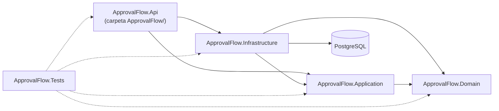
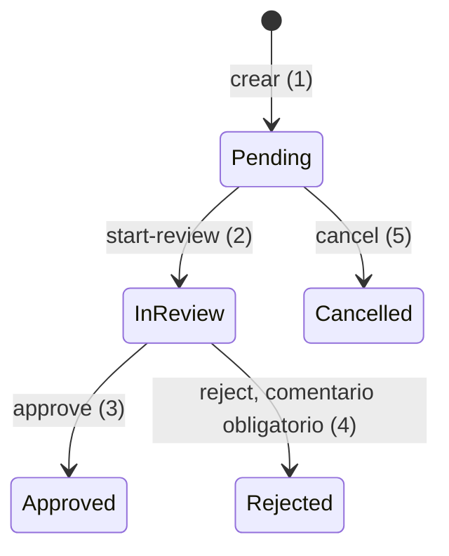

# ApprovalFlow

API REST (.NET 10 / ASP.NET Core) para controlar flujos de aprobación de **solicitudes de compra**. Los roles iniciales son **Solicitante** (Requester), **Aprobador** (Approver), **Finanzas** (Finance) y **Administrador** (Admin).

> Estado: **en desarrollo**.

## Estado actual

- ✅ Entidades de dominio con validaciones y transiciones de estado propias
- ✅ EF Core 10 + PostgreSQL 16 (Docker), migración `InitialCreate`
- ✅ Manejo global de errores (`ProblemDetails`)
- ✅ Autenticación JWT y autorización por roles
- ✅ Gestión de usuarios, departamentos y solicitudes de compra
- ✅ Tests unitarios y de integración (xUnit, `WebApplicationFactory`, EF Core InMemory)
- ⏳ Pendiente: flujo de aprobación de Finanzas en dos niveles (hoy Finanzas es solo lectura). Sin refresh tokens, sin revocación de tokens y sin paginación.

## Stack

- .NET 10 SDK, solución `ApprovalFlow.slnx`
- EF Core 10.0.15 + Npgsql 10.0.3 (PostgreSQL 16)
- JwtBearer + `Microsoft.IdentityModel.JsonWebTokens` (HMAC-SHA256)
- `PasswordHasher<T>` de `Microsoft.Extensions.Identity.Core`
- Swashbuckle (Swagger UI)
- xUnit, `Microsoft.AspNetCore.Mvc.Testing`, EF Core InMemory

## Arquitectura

N-layer Clean Architecture: las dependencias apuntan hacia el Domain.



| Proyecto | Carpeta | Responsabilidad |
|---|---|---|
| `ApprovalFlow.Domain` | `ApprovalFlow.Domain/` | Entidades con validaciones y comportamiento (las transiciones de estado viven en la entidad). Sin paquetes externos. |
| `ApprovalFlow.Application` | `ApprovalFlow.Application/` | Casos de uso, DTOs y abstracciones que implementa Infrastructure. Excepciones propias (`NotFound`, `Conflict`, `Forbidden`, `Unauthorized`). |
| `ApprovalFlow.Infrastructure` | `ApprovalFlow.Infrastructure/` | EF Core + PostgreSQL, configuraciones de entidades, migraciones, seguridad (hash de contraseñas, JWT) y seeder del primer Admin. |
| `ApprovalFlow.Api` | `ApprovalFlow/` | Controllers delgados, middleware de errores, autenticación/autorización y composición de DI en `Program.cs`. |
| `ApprovalFlow.Tests` | `ApprovalFlow.Tests/` | Tests de dominio, aplicación, infraestructura e integración de la API. |

```
ApprovalFlow/
├── ApprovalFlow.Domain/          Entities/, Enums/
├── ApprovalFlow.Application/     Abstractions/ (+ UseCases/), Auth/, Users/, Departments/,
│                                 PurchaseRequests/ (cada uno con su caso de uso y Dtos/), Exceptions/
├── ApprovalFlow.Infrastructure/  Configurations/, Persistence/ (AppDbContext, Migrations, AdminSeeder), Security/
├── ApprovalFlow/                 Controllers/, Middleware/, Extensions/, Authorization/, Program.cs
├── ApprovalFlow.Tests/           Domain/, Application/, Infrastructure/, Api/ (+ Integration/)
├── specs/                        Especificaciones de cada funcionalidad
└── docker-compose.yml            PostgreSQL local
```

Reglas clave:

- Domain no referencia EF Core ni otras capas; Application no referencia Infrastructure, Npgsql ni ASP.NET Core.
- Sin repositorios ni Unit of Work: los casos de uso inyectan `IApplicationDbContext`.
- Los controllers solo delegan; no capturan excepciones (las traduce `GlobalExceptionHandler`).

## Roles

| Valor | Rol | Descripción |
|---|---|---|
| 1 | Admin | Gestiona usuarios y departamentos; ve todas las solicitudes. No requiere departamento. |
| 2 | Requester (Solicitante) | Crea, edita y cancela sus propias solicitudes. |
| 3 | Approver (Aprobador) | Revisa, aprueba o rechaza solicitudes de su departamento. |
| 4 | Finance (Finanzas) | Solo lectura de todas las solicitudes (por ahora). |

Requester, Approver y Finance deben pertenecer a un departamento. `UserRole` se serializa como número en el JSON.

## Funcionalidades y endpoints

Todos los endpoints (salvo el login) requieren `Authorization: Bearer <token>`.

### Autenticación

| Método | Ruta | Acceso |
|---|---|---|
| POST | `/api/auth/login` | Público |

Los fallos de login (correo desconocido, contraseña incorrecta, usuario inactivo) devuelven el mismo 401 `Credenciales inválidas.`. Claims del token: `sub`, `email`, `name`, `role`, `department_id` (si aplica) y `jti`.

### Usuarios (`/api/users`)

| Método | Ruta | Acceso |
|---|---|---|
| GET | `/api/users`, `/api/users/{id}` | Admin |
| POST | `/api/users` | Admin |
| PUT | `/api/users/{id}` | Admin |
| PUT | `/api/users/{id}/role` | Admin |
| POST | `/api/users/{id}/activate`, `/deactivate`, `/reset-password` | Admin |
| GET | `/api/users/me` | Autenticado |
| PUT | `/api/users/me/password` | Autenticado |

Un Admin no puede cambiar su propio rol ni desactivarse.

### Departamentos (`/api/departments`)

| Método | Ruta | Acceso |
|---|---|---|
| GET | `/api/departments`, `/api/departments/{id}` | Autenticado |
| POST / PUT | `/api/departments`, `/api/departments/{id}` | Admin |
| POST | `/api/departments/{id}/activate`, `/deactivate` | Admin |

El nombre es único sin distinguir mayúsculas (409) y no se puede desactivar un departamento con usuarios activos (409).

### Solicitudes de compra (`/api/purchase-requests`)

| Método | Ruta | Acceso |
|---|---|---|
| GET | `/api/purchase-requests?status=` | Autenticado (según visibilidad) |
| GET | `/api/purchase-requests/{id}` | Autenticado (según visibilidad) |
| POST | `/api/purchase-requests` | Requester |
| PUT | `/api/purchase-requests/{id}` | Requester |
| POST | `/api/purchase-requests/{id}/cancel` | Requester |
| POST | `/api/purchase-requests/{id}/start-review` | Approver |
| POST | `/api/purchase-requests/{id}/approve` | Approver |
| POST | `/api/purchase-requests/{id}/reject` | Approver |

- **Visibilidad**: el Requester ve las suyas, el Approver las de su departamento, Finance y Admin todas. Una solicitud inexistente o no visible devuelve el mismo 404.
- El número de solicitud tiene formato `PR-{yyyy}-{n:D6}` (secuencial por año UTC).
- Las acciones responden 200 con el `PurchaseRequestDto` actualizado; `Status` se serializa como número.
- El listado se ordena por `CreatedAt` descendente, sin paginación.

### Flujo de estados



Reglas de dominio: solo el solicitante dueño edita o cancela (y solo en `Pending`); el aprobador debe ser del mismo departamento y no puede revisar su propia solicitud; el monto debe ser mayor que 0 con máximo 2 decimales. Una transición inválida devuelve 409.

## Manejo de errores

`GlobalExceptionHandler` convierte las excepciones en respuestas `ProblemDetails`:

| Excepción | HTTP |
|---|---|
| `NotFoundException` | 404 |
| `ConflictException` | 409 |
| `ForbiddenException` | 403 |
| `UnauthorizedException` | 401 |
| `ArgumentException` (dominio) | 400 |
| `InvalidOperationException` (dominio) | 409 |
| Cualquier otra | 500 (mensaje genérico; el detalle solo en el log) |

## Puesta en marcha

Requisitos: .NET 10 SDK, Docker y la herramienta `dotnet-ef`.

1. Base de datos local:
   ```bash
   cp .env.example .env        # ajusta DB_NAME, DB_USER, DB_PASSWORD y DB_PORT
   docker compose up -d
   ```
2. Configuración (en `appsettings.Development.json`, user-secrets o variables de entorno):
   - `ConnectionStrings:DefaultConnection`
   - `Jwt:Key` (mínimo 32 bytes; en otros entornos usa `Jwt__Key`). La API no arranca sin ella.
   - `SeedAdmin:FullName`, `SeedAdmin:Email`, `SeedAdmin:Password`: crea el primer Admin al iniciar si no existe ninguno.
3. Migraciones y ejecución:
   ```bash
   dotnet restore ApprovalFlow.slnx
   dotnet ef database update --project ApprovalFlow.Infrastructure --startup-project ApprovalFlow
   dotnet run --project ApprovalFlow/ApprovalFlow.Api.csproj
   ```

Swagger UI (con esquema Bearer) está en `/swagger` solo en Development. `ApprovalFlow/ApprovalFlow.http` contiene peticiones de ejemplo con una variable `@token`.

Nueva migración:

```bash
dotnet ef migrations add <Nombre> --project ApprovalFlow.Infrastructure --startup-project ApprovalFlow
```

## Tests

```bash
dotnet test                                                    # todos
dotnet test --filter "FullyQualifiedName~Api.Integration"      # solo integración
dotnet test --filter "FullyQualifiedName~<Clase>.<Metodo>"     # uno solo
```

Los tests de integración usan `WebApplicationFactory<Program>` con EF Core InMemory, por lo que no necesitan PostgreSQL.

## Especificaciones

| # | Spec |
|---|---|
| 01 | [PostgreSQL con Docker](specs/01-postgresql-docker.md) |
| 02 | [Entidades de dominio](specs/02-entidades-dominio.md) |
| 03 | [Configuración de EF Core](specs/03-configuracion-ef-core.md) |
| 04 | [Manejo global de errores](specs/04-manejo-global-errores.md) |
| 05 | [Casos de uso de usuarios](specs/05-casos-de-uso-usuarios.md) |
| 06 | [Autenticación JWT](specs/06-autenticacion-jwt-usuarios.md) |
| 07 | [Casos de uso de departamentos](specs/07-casos-de-uso-departamentos.md) |
| 08 | [Casos de uso de solicitudes de compra](specs/08-casos-de-uso-solicitudes-compra.md) |
